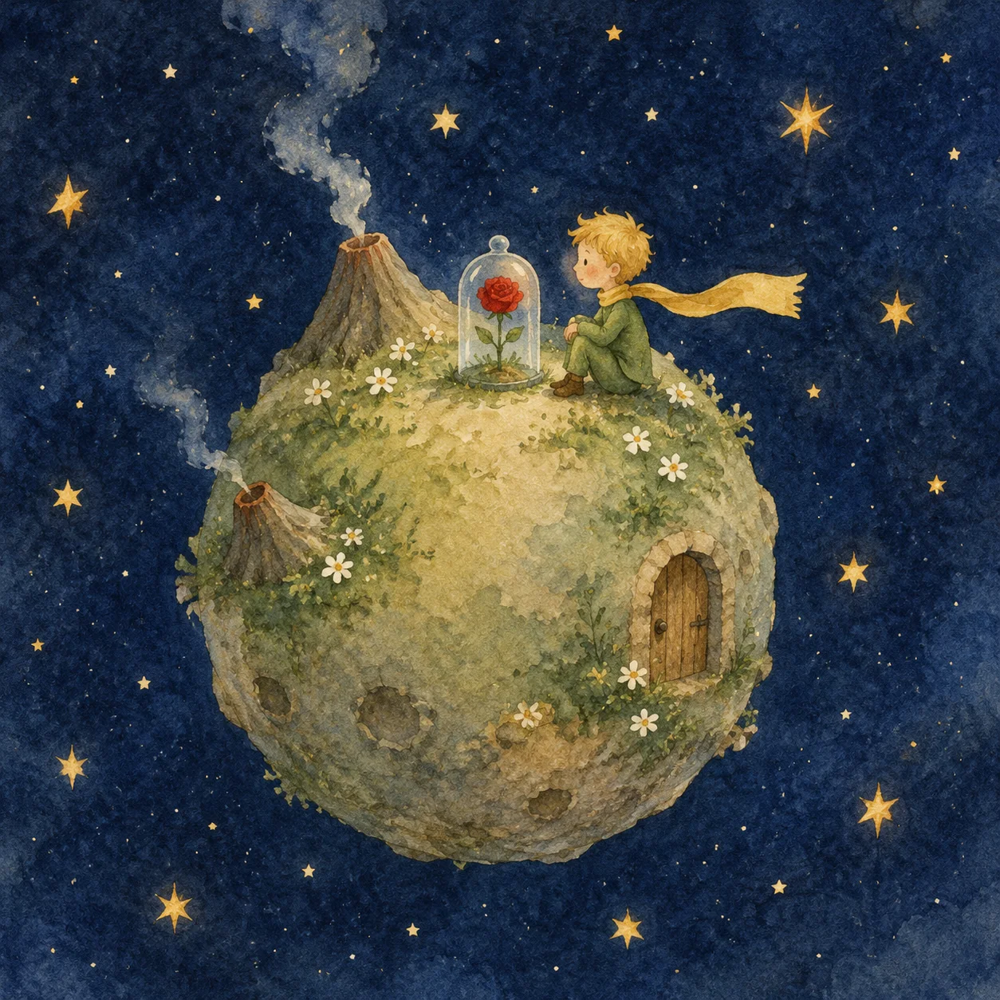
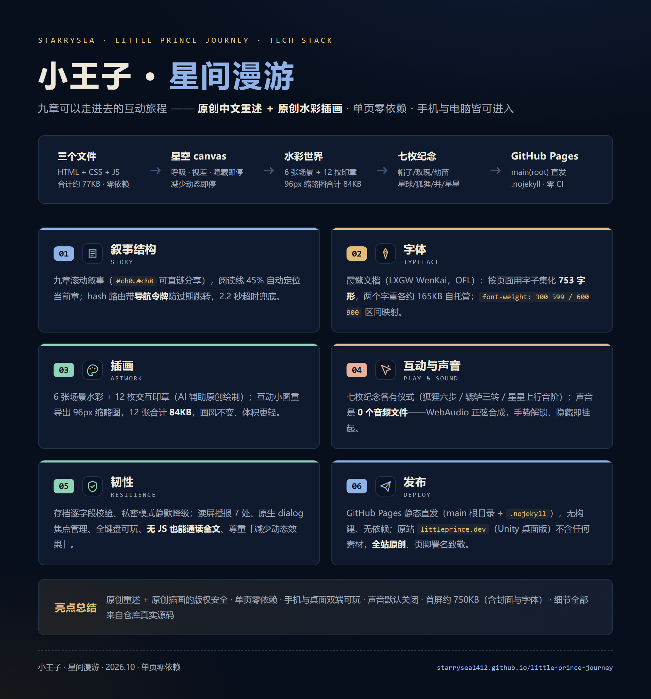

# 小王子 · 星间漫游

一场献给曾经是孩子的大人的旅行：九章互动旅程、原创中文重述、原创水彩插画、一片可以点亮的星空。单页零依赖，**手机与电脑都可以进入**。

**[开始旅程 →](https://starrysea1412.github.io/little-prince-journey/)**



旅途中的七次相遇：看见帽子里的蟒蛇、给玫瑰浇一点水、拔掉猴面包树的幼苗、拜访六颗大人的星球、耐心地驯养一只狐狸、转动三次辘轳打一桶水、让星星笑出声。

这一版把旅程做得更像一本可以走进去的绘本：水彩星球封面、图文分镜、九站旅程星图、上一章 / 下一章与阅读进度。章节位置和互动纪念自动保存在当前浏览器；重新打开后可以从封面「继续上次的旅程」。声音默认关闭，可由右上角开启；全屏入口会在支持的桌面浏览器显示。

> 改编自安托万·德·圣埃克苏佩里《小王子》（1943）。全部文字为**原创重述**，全部插图为**原创绘制**（AI 辅助生成），向原作致敬。
>
> 灵感来自 [littleprince.dev](https://littleprince.dev/) 的 Unity 互动版；本作是网页原生的独立实现，不含其任何素材，并额外支持移动端。

## 技术栈全景图



---

站点无需构建或安装依赖：`index.html` 承载故事，`assets/journey.css` 负责响应式排版，`assets/journey.js` 负责互动、WebAudio 音效与本地进度。原始插画位于 `assets/`；互动邮票使用 `assets/thumbs/` 中的 12 张缩略图，合计约 84 KB，较对应原图减少约 94.6%。

本地预览（在仓库目录运行）：

```sh
python -m http.server 4286 --bind 127.0.0.1
```

浏览器访问 `http://127.0.0.1:4286/`。发布到 GitHub Pages 时直接部署仓库静态文件即可。

支持键盘导航、原生对话框焦点管理、互动结果播报与系统「减少动态效果」偏好。禁用 JavaScript 时仍可从上到下阅读完整故事。

排版字体为**霞鹜文楷 LXGW WenKai**（SIL Open Font License 1.1），已按本站用字子集化后自托管于 `assets/fonts/`（两个字重各约 165KB）；字体许可原文见 `assets/fonts/OFL.txt`。
